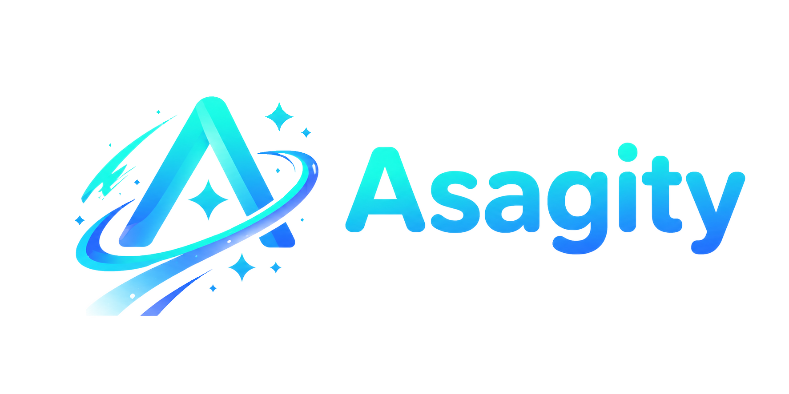

<div align="center">
  
  <h1>Asagity (アサギティ)</h1>
  <p><b>The Glacier-tinted Decentralized Social Universe.</b></p>
   
  [](LICENSE)
  [](web/)
  [](core/)
  []()
   
  [English](./README.md) | [简体中文](./README_CN.md)
</div>

---

## What is Asagity?

**Asagity** is a modern, anime-inspired, decentralized federated social platform developed by **CyaniAgent**. 
It's not just another microblogging instance; it's a digital utopia that combines real-time social networking with a powerful multi-backend cloud drive. 

Built on the self-developed **Verse for Asagity** backend engine, leveraging the Verse primary protocol with ActivityPub compatibility, Asagity allows you to seamlessly interact with users across the entire Fediverse (Mastodon, Misskey, Pleroma, etc.), all while enjoying a highly customizable tab-based experience.

> The current seasonal skin is **Yukinoshita Glacier (2026.Q4)** — glacier blue × frost neutrals. The classic Miku Green has retired from the token system (archived in git history); see [`docs/design-tokens.md`](docs/design-tokens.md).

## Key Features

- **Native Federation**: Built on the self-developed Verse for Asagity backend engine, leveraging the Verse primary protocol with ActivityPub compatibility. Connect, reply, and resonate with the entire Fediverse.
- **Skyline Drive**: A built-in, powerful cloud drive system. Supports local storage, S3-compatible object storage, and remote WebDAV mounting. Features chunked uploads and a native file manager UI.
- **Topics System**: Community-driven topic discovery with activity tracking, trending analysis, and real-time post integration.
- **Highly Customizable UI**: Breaking the traditional three-column layout. Asagity adopts an advanced tab mechanism with on-open loading, on-close release, minimized-page preloading, free-floating windows, a left-rail page manager and right-rail widgets — an OS-level page experience.
- **Termity Terminal**: An in-app Unix-style terminal with bash-style command history, zsh-style inline suggestions, tmux-style multi-session, and a server-minted guest-entry verification gate.
- **Rich Toy-like Widgets**: Built-in mini music player with lyrics sync, custom dynamic emojis, typing effects, and honest live status pills.
- **Blazing Fast**: A Go core engine for massive concurrent federation broadcasting (EventBus, WebSocket push), an ASP.NET Core API for the public surface, and React 19 for instant client-side delivery.

## Tech Stack

Asagity is built as a symmetric Monorepo, separating the client layer from the server core.

*   **Client (`/web`)**: React 19, Vite, Tailwind CSS v4, Zustand, Astryx design system.
*   **Server (`/core`)** — dual-engine, split by responsibility (see [`docs/architecture/tech-stack-audit.md`](docs/architecture/tech-stack-audit.md)):
    *   **Go (`Verse.Engine`, `:2048`)**: core services — EventBus, WebSocket push, VSQL search, ActivityPub federation.
    *   **ASP.NET Core (`Verse.Api` + `Verse.Modules`, `:2050`)**: public REST API and business modules, backed by EF Core (`Verse.Data`) sharing one database with GORM.
*   **Tooling (`Verse.Cli`)**: `versetool` — dual-process supervisor with an interactive **Termity Base CLI** REPL (`/start` `/status` `/doctor` `/recent` …).
*   **Infrastructure**: PostgreSQL (main database with JSONB), Valkey (cache & queue).
*   **Testing**: xUnit (.NET), Vitest + Playwright (web).
*   **Container Runtime**: Docker & Podman support with separate container configs.

## Getting Started

### Prerequisites
- [Node.js](https://nodejs.org/) (v20+) & [pnpm](https://pnpm.io/)
- [Go](https://go.dev/) (v1.26+)
- [.NET SDK](https://dotnet.microsoft.com/) (v10)
- Docker or Podman

### 1. Setup Infrastructure

Clone the repository, create the env file, and spin up PostgreSQL and Valkey using Docker or Podman:

```bash
git clone https://github.com/CyaniAgent/Asagity.git
cd Asagity
cp .env.example .env
```

**For Docker:**
```bash
docker compose -f container/docker/docker-compose.yaml up -d
```

**For Podman:**
```bash
# Start services
cd container/podman && ./start.sh

# Or manually
podman compose -f container/podman/podman-compose.yaml up -d
```

### 2. Start the Server (Core)

`versetool` supervises the dual-process backend: it builds and runs the **Go engine** (`SERVER_PORT`, default `:2048`) together with the **.NET API** (`VERSE_API_PORT`, default `:2050`):

```bash
# One-shot (script-friendly): build + start everything in dev (lite) mode
go run ./core/src/Verse.Cli/cmd/verse start dev

# Or use the prebuilt binary
core/src/Verse.Cli/bin/versetool start dev
```

Run `versetool` with **no arguments on a terminal** to open the **Termity Base CLI** — a semantic `/command` REPL with per-run session journaling:

```
/start /stop /restart /destroy /status /health /doctor
/logs /app /db /mode /recent /help /exit
```

In lite mode the engine seeds a fixed developer account (printed to the logs on first boot) so a fresh checkout can log in immediately.

### 3. Start the Client (Web)
Open a new terminal window:
```bash
cd web
pnpm install
pnpm dev
```
Visit `http://localhost:2000` to enter the Glacier Universe!

## Project Structure

```
Asagity/
├── web/                       # Client (React 19 + Vite)
│   ├── src/
│   │   ├── pages/             # Route pages (about, panel, settings, chat, drive, …)
│   │   ├── components/        # React components (windows, termity, topbar, widgets, …)
│   │   ├── stores/            # Zustand state management (~20 stores)
│   │   ├── i18n/locale/       # i18n (zh-CN, zh-TW, en-US, ja-JP)
│   │   ├── theme/             # 2026.Q4 Yukinoshita Glacier theme (Astryx)
│   │   ├── lib/               # Utilities (backend proxy, termity suggest, …)
│   │   └── hooks/             # Shared React hooks
│   ├── public/                # Static assets (fonts, sounds, PWA)
│   └── vite.config.ts         # Dev server + dual-backend proxy
├── core/                      # Server (Go + ASP.NET Core)
│   └── src/
│       ├── Verse.slnx         # .NET solution
│       ├── Verse.Api/         # ASP.NET Core API entrypoint (:2050)
│       ├── Verse.Modules/     # Business modules (Auth / User / Note / Drive / …)
│       ├── Verse.Data/        # EF Core data layer (shares one DB with GORM)
│       ├── Verse.Shared/      # Response envelope, scopes, CurrentUser
│       ├── Verse.Engine/      # Go core engine (:2048) — EventBus / WS / VSQL / federation
│       ├── Verse.Cli/         # versetool — supervisor + Termity Base CLI
│       └── Verse.Tests/       # xUnit test suite
├── container/                 # Container configurations (Docker / Podman)
├── docs/                      # Documentation (design tokens, API, roadmap, architecture, …)
└── .env.example               # Environment template (ports, DB, Valkey)
```

## Contributing
Asagity is currently in its early development phase. PRs, issues, and feature requests are highly welcome! 

## License
This project is licensed under the [AGPL-3.0 License](LICENSE).

---
<div align="center">
  <i>Crafted with 🩵 by <a href="https://github.com/CyaniAgent">CyaniAgent</a> and every contributor.</i>
</div>
