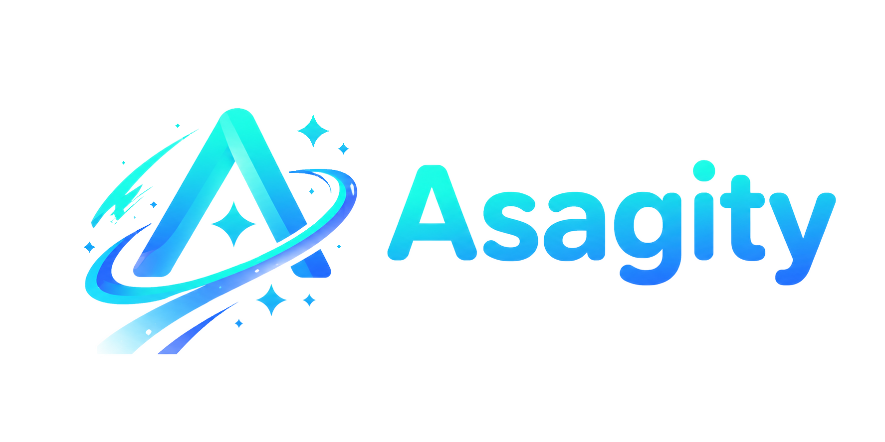

<div align="center">
  
  <h1>Asagity (アサギティ)</h1>
  <p><b>一抹冰蓝色的去中心化多元社交宇宙。</b></p>
   
  [](LICENSE)
  [](web/)
  [](core/)
  []()
   
  [English](./README.md) | [简体中文](./README_CN.md)
</div>

---

## 什么是 Asagity？

**Asagity** 是由 **CyaniAgent** 组织开发的一款充满日系二次元美学、现代化的去中心化联邦社交平台。
它不仅仅是一个微博客实例，更是一个将"实时社交网络"与"强大且多端的云盘系统"完美融合的数字乌托邦。

基于自研的 **Verse for Asagity** 后端引擎，利用 Verse 主协议 + ActivityPub 兼容化协议，Asagity 能够与整个联邦宇宙（Mastodon, Misskey, Pleroma 等）无缝连接与互动。同时，它抛弃了传统枯燥的布局，利用高度可定制性的标签页模式呈现更加自由的体验。

> 当前赛季皮肤为 **Yukinoshita Glacier（雪之下冰河，2026.Q4）** —— 冰河蓝 × 霜雪中性色。经典初音绿已退出 token 体系（品牌档案保留在 git 历史），详见 [`docs/design-tokens.md`](docs/design-tokens.md)。

## 核心特性

- **原生联邦宇宙**：基于自研的 Verse for Asagity 后端引擎，利用 Verse 主协议 + ActivityPub 兼容化协议，跨实例关注、回复、转发，与万千星球产生共鸣。
- **Skyline Drive**：内置超强云盘系统。支持本机存储、S3 对象存储及 WebDAV 远程挂载。支持大文件分片上传，拥有媲美桌面级资源管理器的 UI。
- **话题系统**：社区驱动的话题发现机制，支持活动追踪、趋势分析和实时帖子整合。
- **高度自由可定制 UI**：打破传统三栏布局，采用先进的标签页机制（即开即加载、关闭即释放、最小化预载），配合自由浮动窗口、左侧页面管理器与右侧组件区，打造类操作系统级别的页面体验。
- **Termity 终端**：应用内类 Unix 终端 —— bash 风格命令历史、zsh 风格内联建议、tmux 风格多会话，以及服务端铸造的免登录验证码入口。
- **趣味交互组件**：内置迷你音乐播放器（含歌词同步）、动态自定义表情包、打字机特效签名及诚实的实时在线状态芯片。
- **极致性能驱动**：Go 核心引擎扛住海量联邦并发广播（EventBus / WebSocket 推送），ASP.NET Core 承载公共 API，客户端采用 React 19，首屏秒开，开发体验极致。

## 技术栈

Asagity 采用清晰的 Monorepo（单体仓库）架构，客户端与服务端分离但协同开发：

*   **客户端 (`/web`)**: React 19, Vite, Tailwind CSS v4, Zustand, Astryx 设计体系。
*   **服务端 (`/core`)** —— 双引擎按职责划分（见 [`docs/architecture/tech-stack-audit.md`](docs/architecture/tech-stack-audit.md)）：
    *   **Go (`Verse.Engine`, `:2048`)**: 核心服务 —— EventBus、WebSocket 推送、VSQL 搜索、ActivityPub 联邦。
    *   **ASP.NET Core (`Verse.Api` + `Verse.Modules`, `:2050`)**: 公共 REST API 与业务模块，由 EF Core（`Verse.Data`）提供数据访问，与 GORM 共享同一数据库。
*   **工具链 (`Verse.Cli`)**: `versetool` —— 双进程守护，内置交互式 **Termity Base CLI** REPL（`/start` `/status` `/doctor` `/recent` …）。
*   **底层基建**: PostgreSQL（主数据库，深度依赖 JSONB）, Valkey（缓存与消息队列）。
*   **测试**: xUnit（.NET）, Vitest + Playwright（web）。
*   **容器运行时**: 支持 Docker 与 Podman，配置分离管理。

## 🚀 快速开始

### 环境准备
- [Node.js](https://nodejs.org/) (v20+) & [pnpm](https://pnpm.io/)
- [Go](https://go.dev/) (v1.26+)
- [.NET SDK](https://dotnet.microsoft.com/) (v10)
- Docker 或 Podman

### 1. 启动底层基建
克隆仓库、创建环境变量文件，并使用 Docker 或 Podman 一键启动 PostgreSQL 与 Valkey：

```bash
git clone https://github.com/CyaniAgent/Asagity.git
cd Asagity
cp .env.example .env
```

**Docker:**
```bash
docker compose -f container/docker/docker-compose.yaml up -d
```

**Podman:**
```bash
# 使用启动脚本
cd container/podman && ./start.sh

# 或手动启动
podman compose -f container/podman/podman-compose.yaml up -d
```

### 2. 启动服务端 (Core)

`versetool` 统一守护双进程后端：构建并同时运行 **Go 引擎**（`SERVER_PORT`，默认 `:2048`）与 **.NET API**（`VERSE_API_PORT`，默认 `:2050`）：

```bash
# 一次性启动（脚本友好）：构建 + 以 dev (lite) 模式启动全部服务
go run ./core/src/Verse.Cli/cmd/verse start dev

# 或使用预构建二进制
core/src/Verse.Cli/bin/versetool start dev
```

在终端中**无参数运行 `versetool`** 将进入 **Termity Base CLI** —— 语义化 `/command` REPL，每次运行独立会话留痕：

```
/start /stop /restart /destroy /status /health /doctor
/logs /app /db /mode /recent /help /exit
```

lite 模式下引擎会在首次启动时播种固定的开发者账号（打印到运行日志），全新检出即可直接登录。

### 3. 启动客户端 (Web)
打开一个新的终端窗口：
```bash
cd web
pnpm install
pnpm dev
```
在浏览器中访问 `http://localhost:2000`，欢迎来到冰河之城邦！

## 📁 项目结构

```
Asagity/
├── web/                       # 客户端 (React 19 + Vite)
│   ├── src/
│   │   ├── pages/             # 路由页面 (about, panel, settings, chat, drive, …)
│   │   ├── components/        # React 组件 (windows, termity, topbar, widgets, …)
│   │   ├── stores/            # Zustand 状态管理 (~20 个 store)
│   │   ├── i18n/locale/       # i18n 语言包 (zh-CN, zh-TW, en-US, ja-JP)
│   │   ├── theme/             # 2026.Q4 Yukinoshita Glacier 主题 (Astryx)
│   │   ├── lib/               # 工具函数 (backend 代理, termity 建议, …)
│   │   └── hooks/             # 共享 React hooks
│   ├── public/                # 静态资源 (字体, 音效, PWA)
│   └── vite.config.ts         # 开发服务器 + 双后端代理
├── core/                      # 服务端 (Go + ASP.NET Core)
│   └── src/
│       ├── Verse.slnx         # .NET 解决方案
│       ├── Verse.Api/         # ASP.NET Core API 入口 (:2050)
│       ├── Verse.Modules/     # 业务模块 (Auth / User / Note / Drive / …)
│       ├── Verse.Data/        # EF Core 数据层 (与 GORM 共享同一数据库)
│       ├── Verse.Shared/      # 响应信封、权限 scope、CurrentUser
│       ├── Verse.Engine/      # Go 核心引擎 (:2048) — EventBus / WS / VSQL / 联邦
│       ├── Verse.Cli/         # versetool — 守护进程 + Termity Base CLI
│       └── Verse.Tests/       # xUnit 测试套件
├── container/                 # 容器配置 (Docker / Podman)
├── docs/                      # 文档 (design tokens, API, roadmap, architecture, …)
└── .env.example               # 环境变量模板 (端口, 数据库, Valkey)
```

## 🤝 参与贡献
Asagity 目前正处于火热的早期开发阶段。无论你是擅长 Go 的硬核极客，还是精通 React 的 UI 魔法师，我们都极其欢迎你的 PR 和 Issue！

## 📜 开源协议
本项目采用 [AGPL-3.0 协议](LICENSE) 开源。

---
<div align="center">
  <i>Crafted with 🩵 by <a href="https://github.com/CyaniAgent">CyaniAgent </a> and every contributor.</i>
</div>
