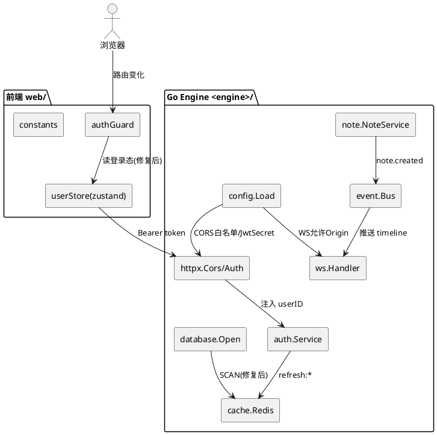
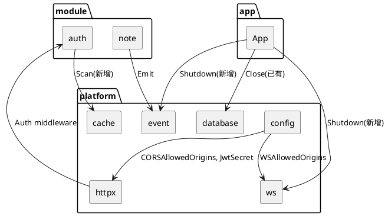
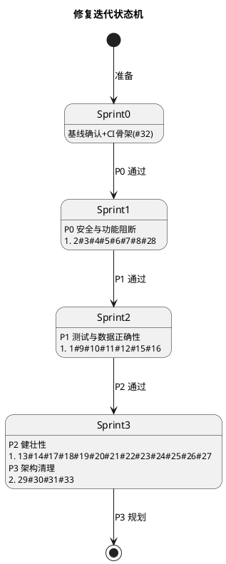
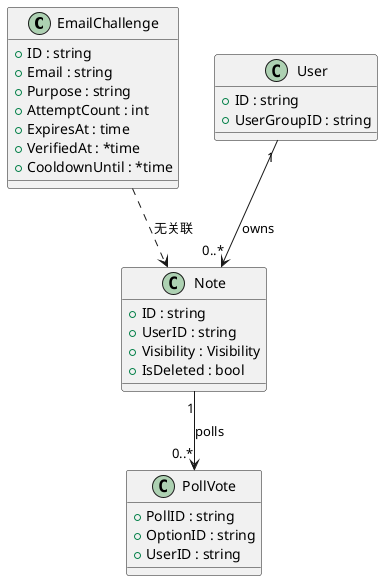

# Asagity 仓库问题修复实现方案（design.md）

> 本文档基于 spec-requirement-agent 阶段对 Asagity 仓库的全面静态审查（`go vet`/`go build`/`go test` + 代码审计），将 33 项发现转化为可落地的技术修复方案。
>
> - **输入**：审查报告 33 项问题（6 严重 / 10 高 / 10 中 / 7 低·架构）
> - **输出**：分批迭代计划 + 每项修复方案 + 验证方法 + 风险评估
> - **路径前缀约定**：Go Engine 实际根为 `core/src/Verse.Engine/`，下文简记为 `<engine>/`；前端根为 `web/`。

---

# 一、需求与存量功能关系分析

## 1.1 需求功能与存量功能对比

本次"需求"的本质是**对存量代码的缺陷修复与安全加固**，而非新增业务功能。因此匹配度评估聚焦于"存量实现是否可被直接复用 / 需改造 / 需新建"。

### 1.1.1 已实现功能（可直接复用的存量能力）

| 需求能力 | 存量功能 | 代码位置 | 匹配度 |
|---------|---------|---------|--------|
| JWT 签发与派生密钥 | `jwtx.DeriveKey` + `jwt.SigningMethodHS256` 签发 | `<engine>/internal/platform/jwtx/key.go`、`auth/service.go:265` | 100% |
| Cookie 读写工具 | `getCookie` 已存在 | `web/src/lib/authGuard.ts:24` | 75%（读已有，写缺失） |
| 公开页面常量 | `PUBLIC_PAGES`（含 `/register`） | `web/src/lib/constants.ts:45` | 100%（与 authGuard 副本不一致） |
| zustand 持久化用户态 | `useUserStore` + `persist` | `web/src/stores/user.ts:23` | 100% |
| EventBus worker 池 | `NewBus` 已起 16 worker | `<engine>/internal/platform/event/bus.go:33` | 75%（池有，但 async 分支绕过池） |
| 幂等存储结构 | `IdempotencyStore` ring buffer | `<engine>/internal/platform/event/idempotency.go` | 50%（结构有，逻辑有 bug） |
| 配置加载与 env 覆盖 | `config.Load` + `envOrDefault` | `<engine>/internal/platform/config/config.go:42` | 100% |
| bcrypt 密码哈希 | `bcrypt.GenerateFromPassword` | `seed.go:108`、`auth/service.go:65` | 100% |
| note 可见性模型 | `Visibility` 字段（public/local/private/direct） | `<engine>/internal/module/note/model/models.go` | 100%（模型有，校验缺失） |

### 1.1.2 需要扩展的功能（部分匹配，需在现有基础上改造）

| 需求功能 | 存量功能 | 差异说明 | 扩展方向 |
|---------|---------|---------|---------|
| 登录态判定来源统一 | `isLoggedIn()` 读 cookie | cookie 从未被写入；真实 token 在 zustand `localStorage` | 改为读 zustand store；或登录时同步写 cookie |
| 公开页面单一事实来源 | `authGuard.PUBLIC_PAGES` 与 `constants.PUBLIC_PAGES` 两份 | authGuard 副本漏 `/register` | authGuard 改为 import constants |
| CORS 安全策略 | `httpx.Cors` 硬编码 `*`+credentials | 非法组合 + 全开放 | 改为从 config 读白名单，回显具体 Origin |
| JWT 算法校验 | `jwt.Parse` keyFunc 未校验 Method | 算法混淆风险 | keyFunc 内断言 `SigningMethodHMAC` |
| WS Origin 校验 | `upgrader.CheckOrigin` 恒 true | 跨站劫持 | 改为白名单匹配 |
| Email challenge 查询 | `GetLatestEmailChallenge("", purpose)` 全局最新 | 并发串号 | 改为按 `challengeID` 精确查询 |
| challenge 失败计数 | 失败时 `CreateEmailChallenge` 当 Update | 数据污染 | 改为 `UpdateEmailChallenge` |
| Redis 批量清理 | `cache.Keys` → `KEYS` | O(N) 阻塞 | 改为 `SCAN` 游标迭代 |
| Idempotency 容量控制 | ring 容量越界 + FIFO 非 LRU | 容量 +1、误驱逐 | 修复驱逐逻辑 + 改 LRU |
| App 优雅停机 | `App` 无 Shutdown | goroutine/连接泄漏 | 新增 `Shutdown()` 并在 serveApp 接管信号 |

### 1.1.3 需要新增的功能或接口

| 业务模块 | 新增功能点 | 输入 / 输出 / 核心逻辑 | 依赖关系 |
|---------|-----------|----------------------|---------|
| 配置 | `JwtSecret` 生产强制校验 | 启动时若 mode=production 且 secret∈弱默认集 → 返回 error | 依赖 `config.Load`、`mode.Resolve` |
| 配置 | CORS 白名单配置项 | 新增 `CORSAllowedOrigins []string`，从 `CORS_ALLOWED_ORIGINS` 读取 | 依赖 config、httpx.Cors |
| 配置 | WS 允许 Origin 配置项 | 新增 `WSAllowedOrigins`，复用 CORS 白名单 | 依赖 config、ws.upgrader |
| 认证 | `UpdateEmailChallenge` 仓储方法 | 入参 challenge（含递增 AttemptCount），UPDATE by ID | 依赖 auth repository |
| 认证 | `GetEmailChallengeByID` 仓储方法 | 入参 challengeID，返回单条 | 替代 GetLatestEmailChallenge 的全局查询 |
| 缓存 | `cache.Scan` 接口方法 | 入参 pattern，出参 keys 游标迭代 | 依赖 go-redis SCAN |
| note | `canViewNote(userID, note)` 内部方法 | 综合 visibility + follow 关系判定 | 依赖 note/follow repository |
| 基础设施 | `App.Shutdown(ctx)` | 关闭 wsServer / eventBus / bridge / DB | 依赖各组件已有 Close |
| CI | `.github/workflows/ci.yml` | lint + vet + test + build 矩阵 | 依赖 Go test、CGO 矩阵 |

## 1.2 存量功能详细分析

### 1.2.1 前端认证链路（authGuard + user store + constants）

- **接口契约**：`isLoggedIn(): boolean` 是守卫唯一登录态来源；`useUserStore.setAuth` 是登录态唯一写入点。
- **业务规则**：`guard()` 顺序为 devMode 绕过 → 未登录拦截非公开页 → 已登录拦截 login/register。
- **约束**：`PUBLIC_PAGES` 在 `authGuard.ts:16` 与 `constants.ts:45` 各持一份副本，已发生漂移（authGuard 漏 `/register`）。`isLoggedIn` 读 `asagity_access_token` cookie，但全仓无写入点（C# `AuthModule.cs:8` 仅写 `refresh_token` cookie，Go 端 access token 走 JSON body，前端存 zustand `localStorage` key=`asagity-user`）。
- **扩展点**：`developerEnter` 在客户端硬编码 `username==="Developer"` 判定 admin（`user.ts:40`），与后端角色完全脱节。

### 1.2.2 后端认证与中间件（httpx + auth service + ws）

- **接口契约**：`httpx.Auth(secret)` 返回中间件，从 `Authorization: Bearer` 解析 JWT 注入 context。`httpx.Cors` 设置 4 个响应头。
- **业务规则**：JWT `keyFunc` 直接返回 `jwtx.DeriveKey(secret)`，**未校验 `token.Method`**，存在 `none`/RS256 伪造风险。CORS 同时设 `Allow-Origin: *` 与 `Allow-Credentials: true`，浏览器规范禁止该组合，带凭证跨域请求全部失败。
- **约束**：`ws.upgrader.CheckOrigin` 恒返回 true，与 CORS 白名单无关联。`auth/service.go` 的 `LogoutAll` 依赖 `cache.Keys("refresh:*")` 即 Redis `KEYS`，生产禁用。

### 1.2.3 数据库自愈与 Seed（database + runtime + seed）

- **接口契约**：`database.findProjectRoot` 查找 `docker-compose.yml`（.yml）；`runtime.findProjectRoot` 查找 `container` 目录。两处实现不一致。
- **业务规则**：实际 compose 文件为 `container/docker/docker-compose.yaml`（.yaml），故 `database.findProjectRoot` 必然失败，Docker 自愈路径走不通。`SeedUserGroups` 用 `count>0` 判断跳过，部分组缺失时永不补齐。`SeedAdministrator` 成功后 `log.Printf` 打印明文密码。
- **约束**：`openPostgres` 硬编码 `TimeZone=Asia/Shanghai`。`runtime.runInitDatabase` 硬编码 `exec.Command("bash", ...)`，Windows 无 bash 时自愈脚本不可执行。

### 1.2.4 EventBus 与幂等（event/bus + idempotency）

- **接口契约**：`Bus.Emit` 非阻塞入 channel（满则 default 丢弃）；`dispatch` 中 `sub.Async` 分支每事件每订阅者起一个 goroutine，**绕过 worker 池**。
- **业务规则**：`IdempotencyStore.Mark` 在 `len(seen)>=capacity` 时仅当 `eviction.Value!=nil` 才删除，首次到达容量时 eviction 全为 nil → 不删除仍插入 → 实际容量 capacity+1；且 ring 是 FIFO，刚处理的事件可能被先驱逐导致重复处理。`randString` 基于 `seededCounter` 单调递增，subscriber ID 完全可预测。
- **约束**：`Bus` 已有 `Shutdown()`，但 `App` 未持有引用调用。

### 1.2.5 note 服务（note/service）

- **接口契约**：`AddReaction(noteID, userID, emoji)` 仅校验 `IsDeleted`，不校验 note 可见性。`VotePoll` 单选时删旧投票，多选时不查重。`UpdateNote` 中 `s.repo.CreateEdit(edit)` 返回值被忽略。`buildTimelineResponse` 用 `userMap[note.UserID]` 取零值兜底。
- **约束**：缺少 `canViewNote` 统一可见性判定，private/direct 帖的 reaction/poll 边界无保护。

### 1.2.6 测试与 CI

- **接口契约**：`internal/platform/database/seed_test.go` 等 6 个用例依赖 `go-sqlite3`（CGO）。
- **约束**：默认 `CGO_ENABLED=0`，Windows 无 gcc，测试 FAIL。`.github/workflows` 不存在，无门禁。

### 1.2.7 C# 双引擎层

- **接口契约**：`Verse.Module.Auth/Service.cs` 等全部为 `NotImplementedXxxService`（每方法抛 501）。
- **约束**：README 宣称"Go + ASP.NET Core 双引擎"，但 .NET 层完全不可用，`/api-net/*` 回退路径永远 501。`pkg/eventbus`、`pkg/vsql`、`pkg/activitypub`、`pkg/websocket` 仅 `doc.go` 占位。
---

# 二、增量设计方案

## 2.1 实现模型

### 2.1.1 上下文视图

修复涉及的核心组件与外部交互关系如下（PlantUML 部署图）：



### 2.1.2 服务/组件总体架构

修复在现有分层内进行，**不引入新顶层模块**，仅在 config / repository / cache 接口层新增方法。组件依赖关系：



### 2.1.3 实现设计文档（分批迭代计划）

修复按依赖关系与风险等级分 4 个批次（Sprint），每批可独立合入并验证：



**批次依赖与执行顺序**：

| 批次 | 内容 | 前置依赖 | 可并行项 |
|------|------|---------|---------|
| Sprint 0 | CI 骨架（#32）+ 基线 `go test` 现状记录 | 无 | — |
| Sprint 1（P0） | #4 config 加固 → #6/#8 白名单 → #7 JWT 算法 → #2/#3/#28 前端认证统一 → #5 日志脱敏 | #4 先行（白名单依赖 config 新字段） | #7 与 #2/#3 前端可并行 |
| Sprint 2（P1） | #1 测试 CGO → #9 findProjectRoot → #10/#11 challenge 查询/更新 → #12 SCAN → #15/#16 note 校验 | #10/#11 共改 auth repo，需串行 | #1、#9、#12、#15/#16 互相独立 |
| Sprint 3（P2+P3） | EventBus/App 健壮性 → seed/错误处理 → C# stub 决策 → 清理 | 无强前置 | 多数可并行 |

## 2.2 接口设计

### 2.2.1 总体设计

本次以**内部方法与配置项变更**为主，对外 HTTP 契约基本不变（仅 CORS 响应头行为收紧）。接口变更策略：

| 类别 | 变更 | 稳定性 |
|------|------|--------|
| `config.Config` 结构 | 新增 `CORSAllowedOrigins`、`WSAllowedOrigins` 字段 | 稳定 |
| `cache.Cache` 接口 | 新增 `Scan(ctx, pattern) iter` 方法 | 稳定（向后兼容，Keys 保留 deprecated） |
| `authrepo.Repository` 接口 | 新增 `GetEmailChallengeByID(id)`、`UpdateEmailChallenge(c)` | 稳定 |
| `App` 结构 | 新增 `Shutdown(ctx)` 方法 | 稳定 |
| HTTP 响应 | CORS `Allow-Origin` 由 `*` 改为具体 Origin 回显 | 行为收紧（预期内） |

### 2.2.2 接口清单

**① config.Config 新增字段**

```go
type Config struct {
    // ...existing fields...
    CORSAllowedOrigins []string // 新增：逗号分隔，从 CORS_ALLOWED_ORIGINS 读取
    WSAllowedOrigins   []string // 新增：复用 CORS 白名单或单独 WS_ALLOWED_ORIGINS
}
```
- 业务说明：驱动 CORS 与 WS Origin 白名单校验。
- 前置条件：`Load()` 完成。
- 后置条件：production 模式下 `JwtSecret` 不在弱默认集，否则 `Load` 返回 error。

**② cache.Cache 新增 Scan**

```go
// Scan 迭代返回匹配 pattern 的 key，内部使用 Redis SCAN（非 KEYS）。
func (c *RedisCache) Scan(ctx context.Context, pattern string, fn func(key string) error) error
```
- 业务说明：替代 `LogoutAll` 中的 `KEYS`，O(N) 非阻塞游标扫描。
- 后置条件：`fn` 对每个匹配 key 调用一次，出错即终止。

**③ auth repository 新增方法**

```go
GetEmailChallengeByID(id string) (*model.EmailChallenge, error)
UpdateEmailChallenge(c *model.EmailChallenge) error
```
- 业务说明：按主键精确查询与更新，替代全局最新查询 + Create 当 Update。
- 后置条件：`AttemptCount` 在同一行递增，`MaxVerificationAttempts` 生效。

**④ App.Shutdown**

```go
func (a *App) Shutdown(ctx context.Context) error
```
- 业务说明：依次关闭 wsServer、eventBus、bridge，超时由 ctx 控制。
- 后置条件：所有后台 goroutine 退出，连接释放。

## 2.3 数据模型

### 2.3.1 设计目标

- 支持 email challenge 的精确查询与原子计数更新（#10/#11）。
- 支持 note 可见性校验所需的 follow 关系读取（#15）。
- 不改变任何现有表结构，仅新增 repository 查询方法。

### 2.3.2 模型实现



- **EmailChallenge**：以 `ID` 为主键精确查询，`AttemptCount` 通过 `UpdateEmailChallenge` 原子递增（`UPDATE ... SET attempt_count = attempt_count + 1`）。
- **PollVote**：多选投票新增 `(poll_id, option_id, user_id)` 唯一约束/查重，防止重复投同一选项。
- **持久化策略**：无 schema 变更；PollVote 唯一性先以应用层查重兜底，后续可加数据库唯一索引。
## 2.4 详细修复方案（按问题编号）

> 约定：每项给出【修改文件/函数】【修改前后关键差异】【依赖与执行顺序】【风险与回滚】。代码片段为关键差异示意，非完整实现。

---

### ▌Sprint 1 — P0 批次（安全与功能阻断）

#### 统一方案：#2 + #3 + #28 前端认证链路统一

三处问题同源——前端登录态判定与公开页配置存在多份不一致副本，且登录态来源与实际存储脱节。统一为**单一事实来源 + zustand 驱动**方案。

**修改文件/函数**：
- `web/src/lib/authGuard.ts`：`PUBLIC_PAGES`、`isLoggedIn`、`REDIRECT_WHEN_LOGGED_IN`
- `web/src/stores/user.ts`：`isAdmin` getter（#28）、`developerEnter`
- `web/src/lib/constants.ts`：保持为唯一 `PUBLIC_PAGES` 来源

**修改前后关键差异**：

`authGuard.ts` —— 删除本地副本，改 import；登录态改读 zustand：
```ts
// 修改前
const PUBLIC_PAGES = ["/", "/login", "/about"];          // #3 漏 /register
const REDIRECT_WHEN_LOGGED_IN = ["/login"];
export function isLoggedIn(): boolean {
  return !!getCookie("asagity_access_token");             // #2 cookie 从未写入
}

// 修改后
import { PUBLIC_PAGES, ROUTES } from "@/lib/constants";
const REDIRECT_WHEN_LOGGED_IN = [ROUTES.LOGIN, ROUTES.REGISTER];
export function isLoggedIn(): boolean {
  return useUserStore.getState().isLoggedIn;             // 单一事实来源
}
```
> 注：`REDIRECT_WHEN_LOGGED_IN` 同步补 `/register`，已登录用户访问注册页也跳首页。

`user.ts` —— #28 客户端不再自判 admin，完全信任后端 role：
```ts
// 修改前
get isAdmin() {
  return get().user?.role === "admin" || get().user?.username === "Developer";
}

// 修改后
get isAdmin() {
  return get().user?.role === "admin";
}
```
`developerEnter` 保留（仅 dev 模式入口），但其 mock user 显式带 `role: "admin"`，移除"按用户名判定"的隐式逻辑。

**依赖与执行顺序**：三文件同批修改，无外部依赖；`authGuard` import `constants` 与 `userStore` 形成单向依赖，无环。

**风险与回滚**：
- 风险：zustand `persist` hydration 在 SSR/首帧前 `isLoggedIn` 可能为 false，导致首跳首页。缓解：`initAuth` 增加 hydration 完成后再 guard（zustand persist 提供 `onRehydrateStorage` 钩子）。
- 回滚：恢复 cookie 读取 + 后端在登录响应 Set-Cookie `asagity_access_token`（备选方案 B）。本方案选 zustand 是因其已是实际存储，改动更小。

---

#### #4 硬编码默认密钥与凭据

**修改文件/函数**：
- `<engine>/internal/platform/config/config.go`：`Load`
- `<engine>/internal/platform/mode/mode.go`（读取已解析 mode）
- `.env.example`、`container/docker/docker-compose.yaml`：移除真实默认值

**修改前后关键差异**：
```go
// 修改前
JwtSecret: envOrDefault("JWT_SECRET", "asagity_secret_miku_39"),

// 修改后：弱默认集 + 生产强制
var weakSecrets = map[string]bool{"asagity_secret_miku_39": true, "": true}

func Load() (Config, error) {
    // ...
    cfg.JwtSecret = os.Getenv("JWT_SECRET")
    if weakSecrets[cfg.JwtSecret] && resolvedMode == mode.Production {
        return Config{}, errors.New("JWT_SECRET must be set to a strong value in production")
    }
    if cfg.JwtSecret == "" { // 非生产允许默认，但打 warning
        cfg.JwtSecret = "asagity_secret_miku_39"
        log.Println("[config] WARNING: using default JWT_SECRET (dev only)")
    }
    // ...
}
```
`seed.go` 的 `ProductionAdministrator.Password` / `LiteDeveloper.Password`：生产密码改为**首次启动随机生成并仅打印一次到 stdout**（引导用户立即保存并改密），或要求通过 `ADMIN_BOOTSTRAP_PASSWORD` env 注入；lite dev 密码保留（仅本地）。

`.env.example` / `docker-compose.yaml`：`JWT_SECRET` 改为占位 `JWT_SECRET=changeme-please-set-a-strong-secret`，并移除 docker-compose 的 `:-asagity_secret_miku_39` 默认回退。

**生产安全加固方向**：密钥从环境变量强制读取，启动时校验长度（≥32 字节）与熵，弱值直接拒绝启动。

**依赖与执行顺序**：config 改动是 #6/#8 白名单的前置。

**风险与回滚**：现有部署若依赖默认 secret 会启动失败——这是预期行为（强制显式配置）。回滚：临时设 env 恢复旧值。

---

#### #5 管理员密码明文写入日志

**修改文件/函数**：
- `<engine>/internal/platform/database/database.go:80-82`（`Open` 内 seed 日志）
- `<engine>/internal/platform/database/lite.go:66-67`（`OpenLite` 内 seed 日志）

**修改前后关键差异**：
```go
// 修改前
log.Printf("[db] seeded administrator account: %s (email: %s, group: %s, password: %s)",
    ProductionAdministrator.Username, ProductionAdministrator.Email,
    AdministratorGroupName, ProductionAdministrator.Password)

// 修改后：仅打印账号标识，密码改为"已打印到 stderr 一次性引导"或完全省略
log.Printf("[db] seeded administrator account: %s (email: %s, group: %s) — see startup banner for one-time credential",
    ProductionAdministrator.Username, ProductionAdministrator.Email, AdministratorGroupName)
```
若需首次告知密码，改为写到**一次性文件** `data/.bootstrap-credential`（权限 0600，读取后由部署脚本删除），绝不进常规日志。

**风险与回滚**：低风险；回滚即恢复日志行。

---

#### #6 CORS 配置非法组合

**修改文件/函数**：
- `<engine>/internal/platform/config/config.go`：新增 `CORSAllowedOrigins`
- `<engine>/internal/platform/httpx/middleware.go`：`Cors` 改为接收白名单

**修改前后关键差异**：
```go
// 修改前
func Cors(next http.Handler) http.Handler {
    return http.HandlerFunc(func(w http.ResponseWriter, r *http.Request) {
        w.Header().Set("Access-Control-Allow-Origin", "*")
        w.Header().Set("Access-Control-Allow-Credentials", "true")
        // ...
    })
}

// 修改后：白名单回显具体 Origin
func Cors(allowed []string) func(http.Handler) http.Handler {
    allowSet := toSet(allowed)
    return func(next http.Handler) http.Handler {
        return http.HandlerFunc(func(w http.ResponseWriter, r *http.Request) {
            origin := r.Header.Get("Origin")
            if allowSet[origin] {
                w.Header().Set("Access-Control-Allow-Origin", origin)
                w.Header().Set("Access-Control-Allow-Credentials", "true")
                w.Header().Set("Vary", "Origin")
            }
            // 非白名单 Origin：不设 Allow-Origin，浏览器自动拒绝跨域
            w.Header().Set("Access-Control-Allow-Methods", "GET, POST, PUT, DELETE, OPTIONS, PATCH")
            w.Header().Set("Access-Control-Allow-Headers", "Content-Type, Authorization")
            if r.Method == "OPTIONS" { w.WriteHeader(http.StatusOK); return }
            next.ServeHTTP(w, r)
        })
    }
}
```
`app.go:37` 调用改为 `mux.Use(httpx.Cors(cfg.CORSAllowedOrigins))`。dev 模式白名单默认含 `http://localhost:2000` 等。

**生产安全加固方向**：白名单从 `CORS_ALLOWED_ORIGINS` 加载，逗号分隔；生产禁止 `*`。

**风险与回滚**：现有跨域调用方若 Origin 不在白名单会被拒——需在 env 配齐。回滚：临时设 `CORS_ALLOWED_ORIGINS=*`（但 credentials 仍需具体 Origin，规范要求）。

---

#### #7 JWT 未校验签名算法

**修改文件/函数**：
- `<engine>/internal/platform/httpx/middleware.go:51`：`Auth` 内 `jwt.Parse` 的 keyFunc

**修改前后关键差异**：
```go
// 修改前
token, err := jwt.Parse(tokenStr, func(token *jwt.Token) (interface{}, error) {
    return jwtx.DeriveKey(secret), nil
})

// 修改后：断言 HMAC 算法，拒绝 none/RS256 等
token, err := jwt.Parse(tokenStr, func(token *jwt.Token) (interface{}, error) {
    if _, ok := token.Method.(*jwt.SigningMethodHMAC); !ok {
        return nil, fmt.Errorf("unexpected signing method: %v", token.Header["alg"])
    }
    return jwtx.DeriveKey(secret), nil
})
```
同步检查 C# `JwtMiddleware.cs`（若启用 .NET 层）做同等 `ValidAlgorithms = ["HS256"]` 校验。

**风险与回滚**：低风险；仅拒绝非法算法 token。回滚：移除断言。

---

#### #8 WebSocket 允许任意 Origin

**修改文件/函数**：
- `<engine>/internal/platform/ws/handler.go:11-17`：`upgrader.CheckOrigin`
- `app.go`：`NewHandler` 调用处传入白名单（或 upgrader 改为包级配置）

**修改前后关键差异**：
```go
// 修改前
var upgrader = websocket.Upgrader{
    CheckOrigin: func(r *http.Request) bool { return true },
}

// 修改后：upgrader 由 NewHandler 按白名单构造
func newUpgrader(allowed []string) websocket.Upgrader {
    allowSet := toSet(allowed)
    return websocket.Upgrader{
        ReadBufferSize: 1024, WriteBufferSize: 1024,
        CheckOrigin: func(r *http.Request) bool {
            return allowSet[r.Header.Get("Origin")]
        },
    }
}
```
`NewHandler` 签名增加 `allowedOrigins []string` 参数，`app.go:73-75` 传入 `cfg.WSAllowedOrigins`（默认复用 `CORSAllowedOrigins`）。

**生产安全加固方向**：WS Origin 白名单与 CORS 同源管理，生产禁止 true。

**风险与回滚**：现有 WS 客户端 Origin 不匹配会连接失败——需配齐白名单。回滚：CheckOrigin 恢复 true。
---

### ▌Sprint 2 — P1 批次（测试与数据正确性）

#### #1 测试套件失败（go-sqlite3 需 CGO）

**修改文件/函数**：
- `<engine>/internal/platform/database/seed_test.go` 等 6 个用例
- 新增 `<engine>/internal/platform/database/testdb_helper.go`（测试 DB 构造）
- `.github/workflows/ci.yml`（#32，CGO 矩阵）

**修改前后关键差异**：
- **方案 A（推荐）**：测试改用纯 Go SQLite 驱动 `modernc.org/sqlite`（无 CGO），通过 gorm `sqlite.New` 适配。生产仍用 `go-sqlite3` 或直接 PostgreSQL。
```go
// 修改前：依赖 CGO 的 go-sqlite3
import _ "github.com/mattn/go-sqlite3"

// 修改后：测试用 modernc.org/sqlite（纯 Go）
import _ "modernc.org/sqlite"
// go.mod 增加 modernc.org/sqlite，build tag 区分
```
- **方案 B**：CI 矩阵在 Linux runner 上 `CGO_ENABLED=1` + 安装 gcc，Windows 仅跑 vet/build 不跑 sqlite 测试（`//go:build !cgo` 跳过）。

本方案选 A：消除 CGO 依赖使测试在任意平台零配置运行，且 `modernc.org/sqlite` 兼容 gorm driver。

**依赖与执行顺序**：与 #32 CI 配合；先切驱动再补 CI 矩阵。

**风险与回滚**：`modernc.org/sqlite` 与 `go-sqlite3` 在少数 DDL/类型上有差异——测试用例若依赖 Postgres-only DDL 需加 build tag 隔离。回滚：恢复 go-sqlite3 + CGO。

---

#### #9 database.go 的 findProjectRoot 永远找不到项目根

**修改文件/函数**：
- `<engine>/internal/platform/database/database.go:260-280`：`findProjectRoot`

**修改前后关键差异**：
```go
// 修改前：仅查 docker-compose.yml（.yml），实际文件是 .yaml
composePath := filepath.Join(dir, "docker-compose.yml")
if _, err := os.Stat(composePath); err == nil { return dir, nil }

// 修改后：同时识别 .yml 与 .yaml，并优先识别 container 目录（与 runtime.go 对齐）
for _, name := range []string{"docker-compose.yml", "docker-compose.yaml"} {
    if _, err := os.Stat(filepath.Join(dir, name)); err == nil { return dir, nil }
}
if _, err := os.Stat(filepath.Join(dir, "container")); err == nil { return dir, nil }
```
统一两处 `findProjectRoot` 实现：抽到公共 helper 或让 `database` 复用 `runtime` 的逻辑，消除副本漂移。

**风险与回滚**：低风险；回滚恢复单一扩展名。

---

#### #10 Email 验证用全局"最新 challenge"查询（并发安全）

**修改文件/函数**：
- `<engine>/internal/module/auth/repository/repository.go`：新增 `GetEmailChallengeByID`
- `<engine>/internal/module/auth/service/service.go:296`、`:415`：`VerifyRegisterEmail`、`VerifyLoginEmail`

**修改前后关键差异**：
```go
// 修改前：全局取最新再比对 ID（并发串号）
challenge, err := s.authRepo.GetLatestEmailChallenge("", "register_with_email")
if challenge.ID != req.ChallengeID { ... }

// 修改后：按主键精确查询
challenge, err := s.authRepo.GetEmailChallengeByID(req.ChallengeID)
if err != nil { return nil, errors.New("challenge not found") }
```
消除 `GetLatestEmailChallenge("", ...)` 第一参数为空串的歧义语义。

**依赖与执行顺序**：与 #11 同改 auth repo，串行。

**风险与回滚**：低风险；回滚恢复旧查询。

---

#### #11 验证失败时用 Create 当 Update（数据污染）

**修改文件/函数**：
- `<engine>/internal/module/auth/repository/repository.go`：新增 `UpdateEmailChallenge`
- `<engine>/internal/module/auth/service/service.go:323`、`:438`：失败分支

**修改前后关键差异**：
```go
// 修改前：Create 当 Update，每次失败新增一行，attempt 计数分散
challenge.AttemptCount++
s.authRepo.CreateEmailChallenge(challenge)

// 修改后：原子更新同一行
challenge.AttemptCount++
if err := s.authRepo.UpdateEmailChallenge(challenge); err != nil {
    return nil, err
}
```
`UpdateEmailChallenge` 内部 `UPDATE email_challenges SET attempt_count=?, cooldown_until=? WHERE id=?`，确保 `MaxVerificationAttempts` 在单行累计生效。

**风险与回滚**：低风险；回滚恢复 Create（但数据污染问题回归）。

---

#### #12 LogoutAll 使用 Redis KEYS（性能）

**修改文件/函数**：
- `<engine>/internal/platform/cache/cache.go`：接口新增 `Scan`
- `<engine>/internal/platform/cache/redis.go`：实现 `Scan`（go-redis `Scan` 游标）
- `<engine>/internal/platform/cache/memory.go`：内存实现遍历
- `<engine>/internal/module/auth/service/service.go:200-215`：`LogoutAll`

**修改前后关键差异**：
```go
// 修改前：KEYS 一次性返回全量，O(N) 阻塞
keys, err := s.cache.Keys(ctx, "refresh:*")
for _, key := range keys { /* del */ }

// 修改后：SCAN 游标迭代，每批 100
err := s.cache.Scan(ctx, "refresh:*", func(key string) error {
    val, _ := s.cache.Get(ctx, key)
    if val == userID { return s.cache.Del(ctx, key) }
    return nil
})
```
`Keys` 方法保留但标注 `// Deprecated: use Scan`。

**风险与回滚**：低风险；SCAN 在大 key 空间下可能返回重复 key，`Del` 幂等无影响。回滚恢复 Keys。

---

#### #15 AddReaction 不校验 note 可见性

**修改文件/函数**：
- `<engine>/internal/module/note/service/service.go:563`：`AddReaction`
- 新增内部方法 `canViewNote(viewerID string, note *notemodel.Note) bool`

**修改前后关键差异**：
```go
// 修改前：仅校验 IsDeleted
if note.IsDeleted { return errors.New(dto.ErrNoteDeleted) }

// 修改后：增加可见性校验
if note.IsDeleted { return errors.New(dto.ErrNoteDeleted) }
if !s.canViewNote(userID, note) {
    return errors.New(dto.ErrNoteForbidden)
}
```
`canViewNote` 规则：`public`/`local` → true；`private` → note.UserID==viewerID 或互关；`direct` → note.UserID==viewerID 或在 mention 列表。复用 follow repository 判定互关。同步对 `VotePoll`（#16 同文件）加同样校验。

**风险与回滚**：低风险；可能拒绝此前"宽松放行"的私密帖 reaction——预期行为。回滚移除校验。

---

#### #16 多选投票可重复投同一选项

**修改文件/函数**：
- `<engine>/internal/module/note/service/service.go:721-737`：`VotePoll` 多选分支

**修改前后关键差异**：
```go
// 修改前：多选不查重，直接 Create
for _, optID := range optionIDs {
    s.repo.CreatePollVote(&PollVote{PollID: poll.ID, OptionID: optID, UserID: userID})
}

// 修改后：多选时过滤已投选项
existingVotes, _ := s.repo.GetUserPollVotes(poll.ID, userID)
voted := /* set of existingVotes.OptionID */
for _, optID := range optionIDs {
    if voted[optID] { continue }   // 跳过已投
    s.repo.CreatePollVote(...)
}
```
可选加固：数据库加 `UNIQUE(poll_id, option_id, user_id)` 索引兜底。

**风险与回滚**：低风险；回滚移除查重。
---

### ▌Sprint 3 — P2 批次（健壮性）

#### #13 Register 方法对带 email 请求永远报错（死代码）

**修改文件/函数**：`<engine>/internal/module/auth/service/service.go:51-63`：`Register`

**修改前后关键差异**：
```go
// 修改前：先查 email 已注册，紧接着对非空 email 直接 return（死代码）
if req.Email != "" {
    if _, err := s.userRepo.GetByEmail(req.Email); err == nil { return nil, errors.New("email already registered") }
}
// ...
if req.Email != "" { return nil, errors.New("email verification required") }

// 修改后：明确 Register 仅处理无 email 的快速注册；带 email 一律走 RegisterWithEmail
// 删除前一段死代码，保留单一直达分支，并在方法注释说明职责边界
if req.Email != "" {
    return nil, errors.New("email verification required; use RegisterWithEmail")
}
```

**风险与回滚**：低风险；回滚恢复死代码（无功能影响）。

---

#### #14 SeedUserGroups 用 count 判断导致组缺失

**修改文件/函数**：`<engine>/internal/platform/database/seed.go:73-83`：`SeedUserGroups`

**修改前后关键差异**：
```go
// 修改前：表里有任意一行就跳过
var count int64
db.Model(&UserGroup{}).Count(&count)
if count > 0 { return nil }

// 修改后：逐组 upsert（FirstOrCreate）
for _, g := range userGroups() {
    if err := db.Where("id = ?", g.ID).FirstOrCreate(&g).Error; err != nil { return err }
}
```

**风险与回滚**：低风险；回滚恢复 count 判断。

---

#### #17 UpdateNote 编辑历史保存错误被吞

**修改文件/函数**：`<engine>/internal/module/note/service/service.go:165`：`UpdateNote`

**修改前后关键差异**：
```go
// 修改前：返回值忽略
s.repo.CreateEdit(edit)

// 修改后：检查错误，失败时记日志（不阻断主流程，编辑历史为辅助数据）
if err := s.repo.CreateEdit(edit); err != nil {
    log.Printf("[note] failed to save edit history for %s: %v", note.ID, err)
}
```

**风险与回滚**：低风险；回滚忽略错误。

---

#### #18 fetchMe 递归调用潜在无限循环

**修改文件/函数**：`web/src/stores/user.ts:157-162`：`fetchMe`

**修改前后关键差异**：
```ts
// 修改前：refresh 成功后无条件再 fetchMe，无深度保护
const refreshed = await get().refreshAccessToken();
if (!refreshed) { get().logout(); }
else { await get().fetchMe(); }

// 修改后：引入深度参数，超过 1 次即放弃
fetchMe: async (depth = 0) => {
  // ...
  const refreshed = await get().refreshAccessToken();
  if (!refreshed || depth >= 1) { get().logout(); }
  else { await get().fetchMe(depth + 1); }
}
```

**风险与回滚**：低风险；回滚移除 depth。

---

#### #19 App 无 Shutdown，goroutine 与连接泄漏

**修改文件/函数**：
- `<engine>/internal/app/app.go`：`App` 新增 `Shutdown`，持有 bridge 引用
- `<engine>/internal/runtime/runtime.go`：`serveApp` 接管 `SIGINT/SIGTERM` 调用 `Shutdown`

**修改前后关键差异**：
```go
// 修改前：App 无关闭方法，serveApp 直接 ListenAndServe
return http.ListenAndServe(addr, r)

// 修改后：App.Shutdown + 信号接管
func (a *App) Shutdown(ctx context.Context) error {
    a.wsServer.Stop()        // 新增 ws.Server.Stop
    a.eventBus.Shutdown()    // 已有
    if a.bridge != nil { a.bridge.Stop() }  // 新增 bridge 引用
    return a.httpServer.Shutdown(ctx)
}
// runtime.serveApp 改用 http.Server + signal.NotifyContext(SIGINT, SIGTERM) → app.Shutdown
```

**依赖与执行顺序**：依赖 ws.Server / bridge 暴露 Stop 方法（若未有则同步补）。

**风险与回滚**：中风险（信号处理改动）；回滚恢复直接 ListenAndServe。

---

#### #20 EventBus Emit 满队列静默丢事件

**修改文件/函数**：`<engine>/internal/platform/event/bus.go:72-84`：`Emit`

**修改前后关键差异**：
```go
// 修改前：满走 default 仅打日志
select {
case b.eventCh <- event:
case <-b.ctx.Done(): return
default: log.Printf("... dropping event")
}

// 修改后：可配置策略——阻塞等待（带超时）或扩容告警
select {
case b.eventCh <- event:
case <-b.ctx.Done(): return
case <-time.After(b.cfg.EmitTimeout):
    log.Printf("[EventBus] emit timeout, dropping: %s", event.Type)
    // 可选：触发 metrics 计数告警
}
```
同时将 channel 容量提升或改为可配置，并在配置项暴露 `EmitTimeout`。

**风险与回滚**：低风险；回滚恢复 default。

---

#### #21 异步 handler 无并发上限

**修改文件/函数**：`<engine>/internal/platform/event/bus.go:126-144`：`dispatch`

**修改前后关键差异**：
```go
// 修改前：sub.Async 每事件起一个 goroutine，绕过 worker 池
if sub.Async { go func(s *Subscriber) { s.Handler(...) }(sub) }

// 修改后：async 也走 worker 池（提交到带缓冲的 asyncCh），或用 semaphore 限并发
if sub.Async {
    b.asyncSem.Acquire(ctx, 1)
    go func(s *Subscriber) {
        defer b.asyncSem.Release(1)
        s.Handler(b.ctx, event)
    }(sub)
} else { sub.Handler(b.ctx, event) }
```
或更彻底：取消 `Async` 标志，所有订阅统一经 worker 池消费（池已存在 16 worker）。

**风险与回滚**：低风险；回滚恢复无限 goroutine。

---

#### #22 IdempotencyStore 容量越界

**修改文件/函数**：`<engine>/internal/platform/event/idempotency.go:23-42`：`Mark`

**修改前后关键差异**：
```go
// 修改前：首次到容量时 eviction.Value 为 nil 不删除仍插入（实际 capacity+1），且 FIFO 非 LRU
if len(s.seen) >= s.capacity {
    oldest := s.eviction.Value
    if oldest != nil { delete(s.seen, oldest.(string)) }
}

// 修改后：改用 LRU（container/list + map），驱逐最旧且非 nil
if len(s.seen) >= s.capacity {
    elem := s.lru.Back()
    if elem != nil {
        delete(s.seen, elem.Value.(string))
        s.lru.Remove(elem)
    }
}
// 命中时 MoveToFront 实现 LRU（而非 FIFO）
```

**风险与回滚**：低风险；回滚恢复 ring（但 bug 回归）。

---

#### #23 randString 名不副实

**修改文件/函数**：`<engine>/internal/platform/event/bus.go:182-198`：`randString`/`seededInt`

**修改前后关键差异**：
```go
// 修改前：seededInt 是单调递增计数器，ID 可预测
var seededCounter int
func seededInt() int { seededCounter++; return seededCounter }

// 修改后：用 crypto/rand 或 math/rand 真随机
func randString(n int) string {
    b := make([]byte, n)
    _, _ = cryptoRand.Read(b)
    for i := range b { b[i] = randChars[b[i]%byte(len(randChars))] }
    return string(b)
}
```

**风险与回滚**：低风险；回滚恢复计数器。

---

#### #24 runtime.go 硬编码 bash 调用

**修改文件/函数**：`<engine>/internal/runtime/runtime.go:136-160`：`runInitDatabase`

**修改前后关键差异**：
```go
// 修改前：Windows 仍调 bash
cmd := exec.Command("bash", initScript)

// 修改后：按平台选解释器
var cmd *exec.Cmd
if isWindows() {
    cmd = exec.Command("powershell", "-ExecutionPolicy", "Bypass", "-File", initScript+".ps1")
} else {
    cmd = exec.Command("bash", initScript)
}
```
确保 `scripts/container/initDatabase.ps1` 存在（审查中 database.go 已引用该 hint）。

**风险与回滚**：低风险；回滚恢复 bash。

---

#### #25 parseInitResult 用 Contains 判布尔

**修改文件/函数**：`<engine>/internal/runtime/runtime.go:176-196`：`parseInitResult`

**修改前后关键差异**：
```go
// 修改前：not_true 会被误判
ready = strings.Contains(line, "true")

// 修改后：精确比较
ready = strings.TrimPrefix(line, "ASAGITY_DB_READY=") == "true"
```

**风险与回滚**：低风险；回滚恢复 Contains。

---

#### #26 openPostgres 硬编码时区

**修改文件/函数**：`<engine>/internal/platform/database/database.go:149-157`：`openPostgres`

**修改前后关键差异**：
```go
// 修改前
dsn := fmt.Sprintf("... TimeZone=Asia/Shanghai", ...)

// 修改后：从 env 读取，默认 UTC
tz := envOrDefault("TZ", "UTC")
dsn := fmt.Sprintf("... TimeZone=%s", cfg.DBHost, ..., tz)
```
`config.Config` 增加 `TimeZone` 字段，`docker-compose.yaml` 已有 `TZ` env 透传。

**风险与回滚**：低风险；回滚恢复硬编码。

---

#### #27 buildTimelineResponse 不处理缺失用户

**修改文件/函数**：`<engine>/internal/module/note/service/service.go:493-534`：`buildTimelineResponse`

**修改前后关键差异**：
```go
// 修改前：userMap[note.UserID] 取零值，DTO 出现空用户
user := userMap[note.UserID]

// 修改后：缺失用户则跳过该 note（或标记为"已注销"占位）
user, ok := userMap[note.UserID]
if !ok {
    log.Printf("[note] timeline: note %s references missing user %s, skipping", note.ID, note.UserID)
    continue
}
```

**风险与回滚**：低风险；回滚恢复零值（但 DTO 会出现空用户）。

---

### ▌Sprint 3 — P3 批次（架构清理与规划）

#### #28 developerEnter 客户端 mock admin

已在 P0 统一方案（#2+#3+#28）中处理：移除 `username==="Developer"` 判定，`developerEnter` mock user 显式带 `role:"admin"`，且该入口仅在 dev 模式可用。

#### #29 C# 模块全部是 501 stub

**决策方向**（二选一，建议先做 A）：
- **方案 A（推荐，本迭代）**：在 README 与路由层明确标注 .NET 层为"规划中，未实现"，`/api-net/*` 回退路径返回 `503 Service Unavailable`（而非 501）并附说明，避免误导。移除"双引擎"宣称或标注"Go 引擎为当前唯一实现"。
- **方案 B（后续规划）**：按 Go 端逻辑逐模块实现 C# Service（Auth → User → Note ...），工作量大，列为独立 epic。

**修改文件/函数**：`Verse.Module.*/Service.cs`（501→503 + 说明）、`README.md`/`README_CN.md`。

**风险与回滚**：低风险；回滚恢复 501。

#### #30 误导性日志

**修改文件/函数**：`<engine>/internal/app/app.go:52`

**修改前后关键差异**：
```go
// 修改前
log.Println("[app] Asagity NET Core EventBus initialized")
// 修改后
log.Println("[app] Asagity EventBus initialized")
```

#### #31 pkg/eventbus 等只有 doc.go 占位

**决策方向**：在 README/架构图中标注 `pkg/*` 为"接口规约占位，实现在 `internal/platform/`"，或删除占位包避免误导。本迭代选标注（保留规约意图）。

#### #32 缺少 CI/CD

**修改文件/函数**：新增 `.github/workflows/ci.yml`

**方案内容**：
```yaml
# 矩阵：go vet + go build + go test（Linux CGO=1 跑 sqlite，Windows CGO=0 跑非 sqlite 用例）
# 前端：pnpm install + pnpm build + pnpm test
# 安全：gosec / govulncheck 扫描
# 触发：push + PR
```
与 #1（测试驱动切换）配合：CI 主矩阵用 `modernc.org/sqlite`（无 CGO），附加一个 CGO 矩阵验证生产驱动。

**风险与回滚**：低风险；回滚删除 workflow。

#### #33 docker-compose.yaml 使用已废弃的 version 字段

**修改文件/函数**：`container/docker/docker-compose.yaml:1`

**修改前后关键差异**：
```yaml
# 修改前
version: '3.8'
services: ...
# 修改后（删除 version 行）
services: ...
```

**风险与回滚**：低风险；回滚恢复 version 行。
---

## 2.5 验证方法

每批次合入前需通过对应验证。下表给出每项问题的验证命令与预期结果。

### 2.5.1 构建与测试基线

| 验证项 | 命令 | 预期 |
|--------|------|------|
| Go 静态检查 | `cd core/src/Verse.Engine && go vet ./...` | 无告警 |
| Go 构建 | `go build ./...` | 通过 |
| Go 测试（无 CGO） | `go test ./...`（切 modernc.org/sqlite 后） | 全绿，含原 6 个 seed 用例（#1） |
| Go 测试（CGO 矩阵） | `CGO_ENABLED=1 go test ./internal/platform/database/...`（Linux） | 全绿 |
| 前端构建 | `cd web && pnpm build` | 通过 |
| 前端测试 | `pnpm test` | 通过 |

### 2.5.2 逐项验证

| # | 验证方法 | 预期结果 |
|---|---------|---------|
| #2 | 浏览器登录后刷新任意受保护页，观察是否仍保持登录态；`useUserStore.getState().isLoggedIn` 为 true | 守卫不再误判匿名 |
| #3 | 未登录访问 `/register` | 正常进入注册页，不被重定向 |
| #4 | production 模式不设 `JWT_SECRET` 启动 | 启动失败并提示需设置强密钥 |
| #5 | 全新 seed 后检查日志/容器 stdout | 不含明文密码 |
| #6 | 浏览器从非白名单 Origin 发带凭证跨域请求 | 被拒（无 Allow-Origin 头）；白名单 Origin 正常 |
| #7 | 用 `alg:none` 伪造 JWT 请求受保护接口 | 401，日志记录 unexpected signing method |
| #8 | 从非白名单 Origin 发起 WS 连接 | 升级握手被拒 |
| #9 | 删除 PG/Redis 后启动 production 模式 | `findProjectRoot` 找到 `container/docker/docker-compose.yaml`，自愈路径生效 |
| #10 | 两用户并发注册邮箱验证，各用各自 challengeID | 互不串号，各自验证成功 |
| #11 | 连续输错验证码 5 次 | 单行 `attempt_count=5`，第 6 次被拒；表中无重复行 |
| #12 | 用户有大量 refresh token 时调 `logout-all` | Redis 不阻塞，token 被清理；`redis-cli monitor` 观察 SCAN 而非 KEYS |
| #15 | 用户 A 对 B 的 private note 调 AddReaction | 403 Forbidden |
| #16 | 多选投票对同一 option 连续投 2 次 | 第 2 次被跳过，无重复 PollVote 行 |
| #13 | 带 email 调 `Register` | 明确错误"use RegisterWithEmail"，无死代码分支 |
| #14 | 预置仅 admin 组后重启 | moderator/default 组被补齐 |
| #17 | 编辑 note 内容后查 `note_edits` 表 | 存在历史行；若 repo 失败有日志 |
| #18 | mock 后端持续返回 me 失败，观察 fetchMe | 最多 refresh 1 次后 logout，不无限递归 |
| #19 | `kill -SIGTERM <pid>` | 日志显示优雅停机，goroutine/连接释放（`pprof` 无泄漏） |
| #20 | 灌满 event channel（>1024 并发 emit） | 超时丢弃并告警，不无限阻塞 |
| #21 | 高频事件 + 多 async 订阅 | goroutine 数受 semaphore 上限约束 |
| #22 | 灌入 >capacity 幂等 key | `Size()` ≤ capacity，重复 key 被正确识别 |
| #23 | 连续生成 subscriber ID | 各不相同且不可预测 |
| #24 | Windows 下触发 DB 自愈 | 执行 `initDatabase.ps1` 而非 bash |
| #25 | `.initdb_result` 含 `ASAGITY_DB_READY=not_true` | `ready=false`，无误判 |
| #26 | 设 `TZ=America/New_York` 启动 | PG 连接时区为 America/New_York |
| #27 | timeline 含已注销用户 note | 该 note 被跳过，DTO 无空用户 |
| #28 | 客户端 `user.username="Developer"` 但 role 非 admin | `isAdmin` 为 false |
| #29 | 访问 `/api-net/auth/login` | 503 + 说明，非 501 |
| #30 | 启动日志 | 显示 "Asagity EventBus initialized"，无 "NET Core" |
| #32 | 提 PR | CI 自动跑 vet/build/test/安全扫描 |
| #33 | `docker compose -f container/docker/docker-compose.yaml config` | 无 version 废弃 warning |

### 2.5.3 安全专项验证

- **密钥**：`gosec` 扫描无 G101 硬编码密钥告警；启动时 `JWT_SECRET` 长度 <32 拒绝。
- **CORS/WS**：用 `curl -H "Origin: https://evil.com" -I` 验证无 `Access-Control-Allow-Origin` 回显。
- **JWT**：用 `jwt.io` 构造 `alg:none` token 验证被拒。
- **日志**：`grep -r "Asagity1234\|Asagity-dev1234" <logs>` 无命中。

## 2.6 风险评估与回滚策略

### 2.6.1 总体风险矩阵

| 风险类别 | 涉及项 | 等级 | 缓解措施 |
|---------|--------|------|---------|
| 兼容性破坏 | #4 强制密钥、#6/#8 白名单 | 中 | 提供迁移文档；env 未配时 dev 模式保留宽松默认；生产部署前 checklist |
| 行为收紧 | #2 登录态来源切换、#15/#27 note 校验 | 中 | 充分回归；首帧 hydration 用 onRehydrateStorage 钩子兜底 |
| 测试驱动切换 | #1 modernc.org/sqlite | 低 | CI 双矩阵（modernc + CGO）交叉验证；保留 go-sqlite3 build tag |
| 信号处理改动 | #19 App.Shutdown | 中 | 先在 lite 模式验证，再上 production；保留 fallback 直接 ListenAndServe |
| 数据一致性 | #11 challenge Update | 低 | 一次性迁移脚本清理历史重复行（可选） |

### 2.6.2 回滚策略

- **逐项可回滚**：每项修复独立成 commit，回滚即 revert 单 commit，无交叉污染（除 #2/#3/#28 统一方案需整体 revert）。
- **配置开关**：CORS/WS 白名单、密钥强制校验通过 env 开关（如 `STRICT_SECRET=true`）控制，可运行时降级。
- **数据库**：本次无 schema 变更，无需数据回滚脚本；PollVote 唯一索引为可选加固，不加则回滚零成本。
- **灰度**：P0 安全项优先合入并部署到预发环境验证 1 个迭代周期后再上生产；P1/P2 可按模块灰度。

### 2.6.3 不在本次范围

- C# 模块的真实实现（#29 方案 B）列为独立 epic。
- `pkg/*` 占位包的真实迁移（#31）列为架构治理 epic。
- 数据库 schema 演进（如 PollVote 唯一索引、EmailChallenge 索引优化）在确认方案稳定后单独迭代。

---

## 附录：修复项与批次速查表

| 批次 | 问题编号 | 主题 |
|------|---------|------|
| Sprint 0 | #32 | CI 骨架 |
| Sprint 1（P0） | #2 #3 #28 / #4 / #5 / #6 / #7 / #8 | 前端认证统一 / 密钥 / 日志 / CORS / JWT / WS |
| Sprint 2（P1） | #1 / #9 / #10 #11 / #12 / #15 #16 | 测试 / 项目根 / challenge / SCAN / note 校验 |
| Sprint 3（P2） | #13 #14 #17 #18 #19 #20 #21 #22 #23 #24 #25 #26 #27 | 健壮性 |
| Sprint 3（P3） | #29 #30 #31 #33 | 架构清理 |

> 本文档仅描述实现方案，不包含完整代码实现。后续由 spec-task-agent 据此拆解任务。